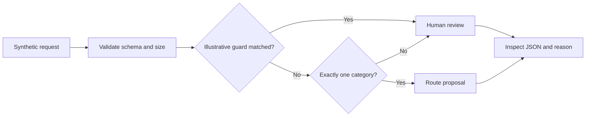

# Workflow triage lab

The [29-classification completeness continuation](completeness-continuation-results.md) is complete: 29/29 final routing matches using31 attempts, with two retained HTTP503 failures recovered on one retry each. Across both windows: previous20/20, updated19/20 (original429 unchanged), rules10/20;42/80 attempts total. On19 common-valid pairs both prompts route19/19: no observed routing gain. Blind AI evidence support is18/19 versus19/19; frozen-fact coverage15/19 versus18/19, with over-demanding criteria flagged on two of the three updated-only coverage differences. Both prompts miss fuller reference coverage on016 while supporting review. The recovered previous013 response has a correct route but unsupported generic-subject evidence. Original outputs/grades remain unchanged; AI review is not human adjudication and the later/slower continuation is not a fresh single-window evaluation. See [every attempt](completeness-continuation-comparison.json) and [semantic findings](completeness-continuation-semantic-comparison.json).

An optional [decisive-evidence selection adapter](COMPLETENESS-EVALUATION-V10.md) preserves the v9 routing policy and one exact-quote contract while asking for the context that actually supports a decision. The paired v10 study holds routing/validation/transport fixed and separately reviews semantic evidence quality with blinded AI output review. The [paired evidence-completeness evaluation](completeness-results.md) is **partial**: HTTP 429 stopped call 11 after five valid pairs, using 11/80 permitted attempts. Both prompts matched all five observed routes and received 5/5 blind AI support and reference-fact coverage judgments: **no observed gain**. Each earns 5/20 all-case credit, with unavailable/unattempted outputs uncredited; rules match 10/20 overall and 4/5 on common-valid cases. One updated call failed; 29 planned classifications remain unattempted. No security cases or ordinary-evidence controls were reached. AI labels and semantic judgments are not human adjudication or production-readiness evidence. See [every call](completeness-comparison.json) and [sealed grades and derived metrics](completeness-semantic-comparison.json).


The separate [twelve-case continuation](sensitive-continuation-results.md) is **complete**: 12/12 classifications, 12/24 continuation attempts, 40/80 cumulative attempts including the original 28. Continuation model matches 12/12 versus rules 5/12 and guard 7/12. The [combined cross-window view](sensitive-combined-comparison.json) retains all original attempted rows and failures: model 37/40, rules 22/40, guard 28/40. Original invalid quote, HTTP 429 and migraine review miss are preserved. Different time windows and 30s versus 6.5s spacing prevent a single-run or causal policy-gain interpretation. Cases and labels are unchanged AI-authored/AI-reviewed, not newly unseen or human-adjudicated. See [all continuation attempts](sensitive-continuation-comparison.json); the original partial report and raw record remain unchanged.


The **partial** [sensitive-context and fictional medical evaluation](sensitive-context-results.md) stopped at HTTP 429 after 28/40 classifications using 28/80 permitted attempts. Twelve cases remain unattempted. One earlier quote was invalid; one valid output missed required review on an actual migraine-medication reminder. Final model exact matches 25/40; rules 22/40; guarded 21/40, retaining failures and unattempted without credit. On the 26 model-valid cases: model 25, rules 16, guard 21; this excludes 14 cases and is not full-set performance. Four observed fictional-medical cases routed correctly; the fifth was unattempted. Valid required-review decisions 14/23; unnecessary reviews 0. See [every attempt and diagnostic](sensitive-context-comparison.json). Labels were separately blind AI-reviewed, not human-adjudicated. This single updated-model versus rules experiment has no paired previous-prompt control and does not establish causal policy gain, stable reliability or production readiness.


An optional [sensitive-context scope adapter](SENSITIVE-EVALUATION-V9.md) now distinguishes real or plausibly real health/financial disclosures from explicitly fictional nonpersonal data. Mixed or unclear scope retains review. Use createSensitiveGeminiAdapter from sensitive-adapter.mjs explicitly; historical adapters and rules remain unchanged. Software tests do not establish semantic gains.


The completed [bounded reliability and negation evaluation](reliability-negation-results.md) used 41/80 allowed attempts for 40 fresh cases. One HTTP 503 retry recovered a valid but incorrect route under the frozen label: availability rose from 39/40 to 40/40 while exact matches stayed 38/40. Rules matched 29/40; guarded final matched 33/40. All 15 negated ordinary requests matched, but two required-review labels were missed; the fictional-medical-context label is explicitly debatable. No first attempt exceeded the old 15-second deadline. This is not an independent legacy-timeout comparison or a measured semantic gain. Labels were AI-authored and separately AI-reviewed, not human-adjudicated. See [every attempt and diagnostic](reliability-negation-comparison.json).


An explicit [bounded reliability adapter](RELIABILITY-EVALUATION-V8.md) now wraps the unchanged v7 prompt and validator. It allows longer bounded waits and one selected transient retry, preserves every failed attempt and stops on quota/auth rejection. Historical transport remains unchanged. Software tests do not establish live availability or semantic gains.

The [fresh account-closure negation comparison](negated-closure-results.md) found **no observed routing gain**: updated v7 matched 36/40, previous v6 38/40, rules 26/40 and guarded v7 29/40. Both prompts made identical correct decisions on all 35 common-valid cases. V7 had two timeouts and two HTTP 503 failures; v6 had one rejected exact quote and one unnecessary review. The v7 call on that remaining review-error case failed, so its correction is unmeasured. All 80 planned calls were attempted once without retries; every failure stays without correctness credit. Labels were AI-authored and separately AI-reviewed, not human-adjudicated. See [every result and diagnostic](negated-closure-comparison.json).


The default Node adapter now checks [account-closure negation and clause scope](NEGATION-EVALUATION-V7.md) before activating protective closure review. The previous v6 prompt remains frozen and selectable. This is a prompt change; tests do not establish semantic improvement. The rules baseline is unchanged.

The completed [vague-request paired evaluation](vague-review-results.md) matched 38/40 cases with the updated v6 prompt, 35/40 with previous v4, and 28/40 with rules. All 80 planned calls were attempted once; the comparison includes one HTTP 503 and one evidence-length violation without correctness credit. V6 reviewed all five vague cases and routed all five terse-clear controls correctly. Both prompts unnecessarily reviewed a negated account-closure example. Labels were authored and separately reviewed by AI, not human-adjudicated; this small synthetic result does not establish production readiness. See [every decision and diagnostic](vague-review-comparison.json).


The optional [bounded-source evidence mode](EVIDENCE-CONTRACT-V5.md) selects request-local excerpt references instead of generating quote text. See the [fresh paired findings and every failure](evidence-contract-results.md) and [machine-readable results](evidence-contract-comparison.json). Labels were authored and separately reviewed by AI agents, not human-adjudicated. Quoted evidence remains the compatibility default; use `createGeminiAdapter({apiKey, evidenceMode: 'indexed-v1'})` to opt in. Exact extraction does not establish semantic support.

The default Node adapter now applies an [intent-sufficiency check before routing vague requests](VAGUE-EVALUATION-V6.md). The paired v6 comparison holds quoted evidence constant and uses a fresh AI-authored, separately AI-reviewed set. Software tests do not establish semantic improvement; see the experiment record for live status and limits. The earlier [signup/account-closure evaluation](REVIEWED-EVALUATION-V4.md) and historical prompts remain available at their frozen revisions.

The adapter now includes [sanitized failure diagnostics and an independently authored input evaluation protocol](DIAGNOSTICS.md). The Bitext-derived evaluation data has its own CDLA-Sharing-1.0 license; see [BITEXT-LICENSE.txt](BITEXT-LICENSE.txt). The source-code license does not restrict that data.

A small, offline engineering demo from [MetaboliQ](https://metaboliq.in): validate a support request, propose a route or abstain, and inspect the evidence before connecting anything to a business system.

**The browser lab is a rules baseline, not a production support agent.** Its offline path uses fictional requests and no external APIs, keys, dependencies, telemetry or customer integrations.

An optional **server-side Gemini adapter and a new 40-case comparison** are now implemented separately from the browser lab. See [MODEL-ADAPTER.md](MODEL-ADAPTER.md) for configuration, tests and live-run status. The original offline quick start and published 30-case results below are unchanged. The adapter requires authorized provider access; mocked tests are not live model measurements.

## Run it

Use Node.js 22 or newer. No dependency installation is required.

```sh
git clone https://github.com/metaboliq-technologies/workflow-triage-demo.git
cd workflow-triage-demo
npm test
npm run demo
npm run evaluate
npm start
```

Open **http://127.0.0.1:8787** for the interactive lab. Stop the local server with Ctrl+C. The server binds only to loopback and serves three allowlisted files. It does not accept uploads or persist requests. The page classifies text in your browser. Use synthetic text only; this is not a sensitive-data processing tool.

For the CLI, run `node cli.mjs sample-requests.json`. To use your own fictional batch, copy that file to `requests.local.json` and run `node cli.mjs requests.local.json`. IDs must be unique, with 1–40 letters, digits, underscores or hyphens. Subjects are required and limited to 140 characters; bodies to 2,000 characters. Batches contain 1–100 requests, at most 1 MiB of UTF-8 JSON. Invalid batches fail atomically with a nonzero exit status.

## What it demonstrates



The supported categories are **access**, **billing** and **technical**. Each decision includes an ID, route, reason, review flag, matched categories and source. It omits the subject and body. No ticket is dispatched, message sent, account changed or payment initiated, regardless of `requiresHumanReview`.

The review flag means the baseline abstained. A false flag is not authorization to execute an action and is not a correctness guarantee. Known cases in the evaluation show why.

## Measured baseline results

Run `node evaluate.mjs` to regenerate the deterministic JSON report. The committed `evaluation-report.json` contains the same results. Six development cases illustrate basic behavior; 30 separate, hand-authored evaluation cases include ambiguity, unsupported language, normalization, negation and guard failures. This is a small synthetic diagnostic set, not a blind benchmark or evidence of customer performance.

| Evaluation metric | Observed result |
| --- | --- |
| Exact route and review match | 25 / 30 (83.3%) |
| Route proposals | 17 / 30 |
| Correct route proposals | 14 / 17 (82.4%) |
| Requests requiring review caught | 11 / 14 (78.6%) |
| External actions executed | 0 |

The five mismatches remain visible rather than being removed or patched away after evaluation:

| Case | Failure | Operational implication |
| --- | --- | --- |
| eval-23 | Access paraphrase is missed | Extra human review |
| eval-25 | Negated billing request is routed to billing | Wrong proposal |
| eval-26 | Quoted security term triggers the guard | Unnecessary escalation |
| eval-27 | Security paraphrase misses the guard | Review bypass in the proposal |
| eval-28 | Destructive intent coexists with a billing term | Review bypass in the proposal |

These results **do not support production automation**. The keyword guards are not complete security, prompt-injection or sensitive-data detectors. English vocabulary, indirect intent, Unicode obfuscation, quoting and context need further work. The test suite verifies software behavior and contracts; passing tests does not erase these policy failures.

## Testing the model boundary

The offline lab does not call or impersonate a model. `reconcileSuggestion` accepts a model-shaped object with exactly `category` and `evidence`. Evidence must be an exact quote from the input. Unknown categories, fabricated evidence, extra fields, ambiguity and model/baseline disagreement go to review. Evidence matching alone does not establish that a suggestion is semantically correct. The optional Node adapter wraps this contract in a separate guarded comparison arm.

```js
import {reconcileSuggestion} from './triage.mjs';

const request = {
  id: 'example-01',
  subject: 'Invoice copy',
  body: 'Please share the fictional invoice.'
};
console.log(reconcileSuggestion(request, {
  category: 'billing',
  evidence: 'invoice'
}));
```

The optional Gemini adapter includes explicit provider configuration, timeouts, bounded retries and a new diagnostic dataset. Running it requires an authorized data-flow and quota decision; see [MODEL-ADAPTER.md](MODEL-ADAPTER.md). Business actions still require a separate authorization boundary. No action executor is included.

## Repository map

| File | Purpose |
| --- | --- |
| triage.mjs | Input validation, baseline policy and model-output contract |
| cli.mjs | Bounded local JSON-file runner |
| index.html / app.mjs | Interactive local lab |
| serve.mjs | Loopback-only, allowlisted static server |
| sample-requests.json | Five fictional examples |
| fixtures.json | Development and evaluation cases with expected decisions |
| evaluate.mjs | Repeatable metrics and mismatch report |
| triage.test.mjs | Contract, input-boundary and CLI tests |

## Contributing and scope

Suggest a failure case with fictional input, the expected decision and a reason. Keep evaluation changes separate from policy changes so improvements can be assessed honestly. Do not submit production records, credentials or personal data in issues or pull requests.

This repository is separate from MetaboliQ's proprietary website and applications. No private application source or customer data is included. It has no Firebase or production deployment configuration. Publishing source here does not grant an open-source license; see `LICENSE`.

[How we work](https://metaboliq.in/how-we-work.html) · [Engineering journal](https://metaboliq.in/blog.html) · [Discuss a project](https://metaboliq.in/contact.html)

## Sufficient evidence comparison v11

[Full v11 results and limitations](sufficient-results.md): 40 classifications, 46 attempts, 37 valid final outputs. On 17 common-valid pairs, no routing or AI-rated support gain; frozen bundle coverage 15/17 to 16/17 includes a criteria ambiguity. All-case joint success 17/20 for both. Three final failures and every retry remain recorded. Separate AI author/label/evidence reviewers; no human validation. Do not rerun the saved live evaluation. Reproduce the audit offline with `node verify-sufficient-evaluation.mjs`.

## Bounded evidence selection v12

[Full v12 evaluation and limitations](selection-results.md): 40 classifications and 45 attempts, all final outputs valid. Updated routing and blind AI-rated evidence support are 20/20, current v11 19/20, and rules routing 9/20; the observed difference is one classifier-injection review miss. Neither arm reproduces the original generic-heading or length failure in this set, so target-failure reduction is unmeasured. Five HTTP 503 attempts recover. Candidate IDs bound quotes and exclude recognized generic headings, but change the extraction pipeline and increase measured tokens; no human validation or production-readiness claim. Audit offline with `node verify-selection-evaluation.mjs`; do not rerun the saved live workflow.

## Focused evidence challenge v13 and separate boundary follow-up

[Main20-case report](challenge-results.md): joint routing/support/coverage is17/20 for v11 and20/20 for v12, including two unsupported direct-quote headings and one121-unit rejection. Its six intended length cases have shorter sufficient witnesses; that design shortfall is preserved.

[Separate six-case follow-up](boundary-results.md), frozen before new authoring and original outcomes: joint success is4/6 for v11 versus2/6 for v12. Bounded formatting does not ensure complete evidence: three reviewed witnesses are absent from candidate choices and another available witness is not selected. Both phases use56/80 combined attempts, with four recovered503 attempts and two direct-quote length rejections (121/123 units). Do not pool the phases or promote v12 as a general improvement. AI review is not human validation. Audit offline with `node verify-challenge-evaluation.mjs` and `node verify-boundary-evaluation.mjs`; do not rerun either live workflow.
