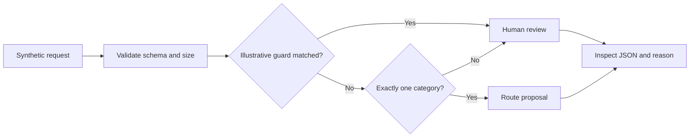

# Workflow triage lab

A small, offline engineering demo from [MetaboliQ](https://metaboliq.in): validate a support request, propose a route or abstain, and inspect the evidence before connecting anything to a business system.

**This is a rules baseline, not an AI model or a production support agent.** A separate contract shows how a future model suggestion can be checked without trusting it to clear a guard. All bundled requests are fictional. No external APIs, keys, dependencies, telemetry or customer integrations are used.

## Run it

Use Node.js 22 or newer. No dependency installation is required.

```sh
git clone https://github.com/metaboliq-technologies/workflow-triage-demo.git
cd workflow-triage-demo
npm test
npm run demo
npm run evaluate
npm start
```

Open **http://127.0.0.1:8787** for the interactive lab. Stop the local server with Ctrl+C. The server binds only to loopback and serves three allowlisted files. It does not accept uploads or persist requests. The page classifies text in your browser. Use synthetic text only; this is not a sensitive-data processing tool.

For the CLI, run `node cli.mjs sample-requests.json`. To use your own fictional batch, copy that file to `requests.local.json` and run `node cli.mjs requests.local.json`. IDs must be unique, with 1–40 letters, digits, underscores or hyphens. Subjects are required and limited to 140 characters; bodies to 2,000 characters. Batches contain 1–100 requests, at most 1 MiB of UTF-8 JSON. Invalid batches fail atomically with a nonzero exit status.

## What it demonstrates



The supported categories are **access**, **billing** and **technical**. Each decision includes an ID, route, reason, review flag, matched categories and source. It omits the subject and body. No ticket is dispatched, message sent, account changed or payment initiated, regardless of `requiresHumanReview`.

The review flag means the baseline abstained. A false flag is not authorization to execute an action and is not a correctness guarantee. Known cases in the evaluation show why.

## Measured baseline results

Run `node evaluate.mjs` to regenerate the deterministic JSON report. The committed `evaluation-report.json` contains the same results. Six development cases illustrate basic behavior; 30 separate, hand-authored evaluation cases include ambiguity, unsupported language, normalization, negation and guard failures. This is a small synthetic diagnostic set, not a blind benchmark or evidence of customer performance.

| Evaluation metric | Observed result |
| --- | --- |
| Exact route and review match | 25 / 30 (83.3%) |
| Route proposals | 17 / 30 |
| Correct route proposals | 14 / 17 (82.4%) |
| Requests requiring review caught | 11 / 14 (78.6%) |
| External actions executed | 0 |

The five mismatches remain visible rather than being removed or patched away after evaluation:

| Case | Failure | Operational implication |
| --- | --- | --- |
| eval-23 | Access paraphrase is missed | Extra human review |
| eval-25 | Negated billing request is routed to billing | Wrong proposal |
| eval-26 | Quoted security term triggers the guard | Unnecessary escalation |
| eval-27 | Security paraphrase misses the guard | Review bypass in the proposal |
| eval-28 | Destructive intent coexists with a billing term | Review bypass in the proposal |

These results **do not support production automation**. The keyword guards are not complete security, prompt-injection or sensitive-data detectors. English vocabulary, indirect intent, Unicode obfuscation, quoting and context need further work. The test suite verifies software behavior and contracts; passing tests does not erase these policy failures.

## Testing a future model boundary

The demo does not call or impersonate a model. `reconcileSuggestion` accepts a model-shaped object with exactly `category` and `evidence`. Evidence must be an exact quote from the input. Unknown categories, fabricated evidence, extra fields, ambiguity and model/baseline disagreement go to review. Evidence matching alone does not establish that a suggestion is semantically correct.

```js
import {reconcileSuggestion} from './triage.mjs';

const request = {
  id: 'example-01',
  subject: 'Invoice copy',
  body: 'Please share the fictional invoice.'
};
console.log(reconcileSuggestion(request, {
  category: 'billing',
  evidence: 'invoice'
}));
```

A real adapter would need an explicit data-flow decision, provider configuration, timeouts, retry limits, cost controls, representative task evaluation and a held-out dataset. Business actions would still need a separate authorization boundary. No adapter or action executor is included here.

## Repository map

| File | Purpose |
| --- | --- |
| triage.mjs | Input validation, baseline policy and model-output contract |
| cli.mjs | Bounded local JSON-file runner |
| index.html / app.mjs | Interactive local lab |
| serve.mjs | Loopback-only, allowlisted static server |
| sample-requests.json | Five fictional examples |
| fixtures.json | Development and evaluation cases with expected decisions |
| evaluate.mjs | Repeatable metrics and mismatch report |
| triage.test.mjs | Contract, input-boundary and CLI tests |

## Contributing and scope

Suggest a failure case with fictional input, the expected decision and a reason. Keep evaluation changes separate from policy changes so improvements can be assessed honestly. Do not submit production records, credentials or personal data in issues or pull requests.

This repository is separate from MetaboliQ's proprietary website and applications. No private application source or customer data is included. It has no Firebase or production deployment configuration. Publishing source here does not grant an open-source license; see `LICENSE`.

[How we work](https://metaboliq.in/how-we-work.html) · [Engineering journal](https://metaboliq.in/blog.html) · [Discuss a project](https://metaboliq.in/contact.html)
